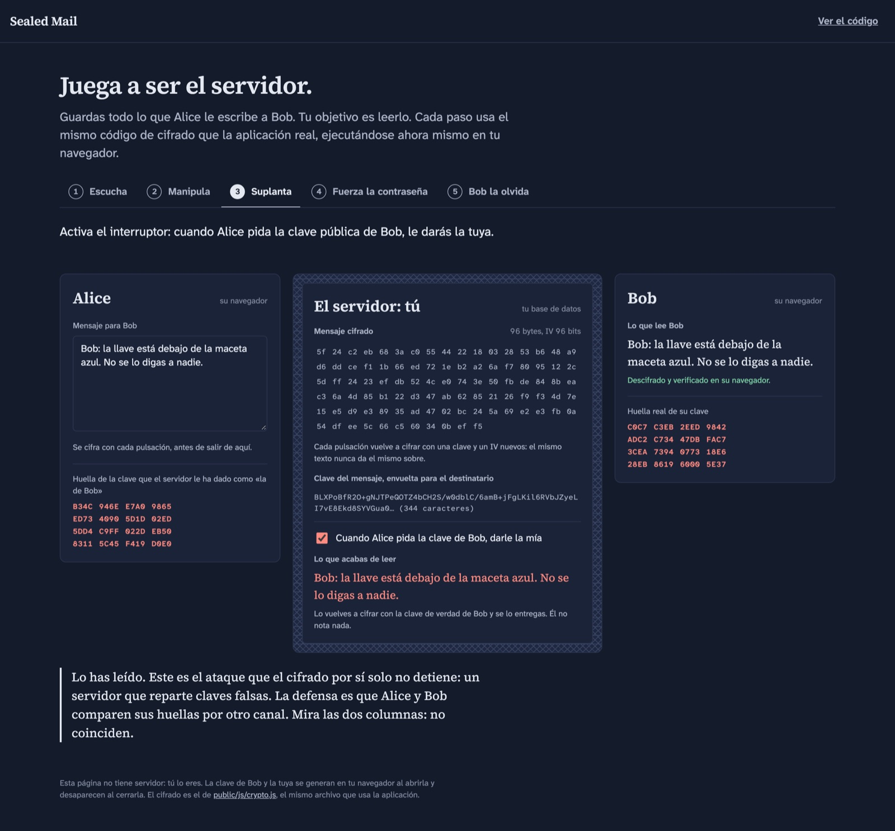
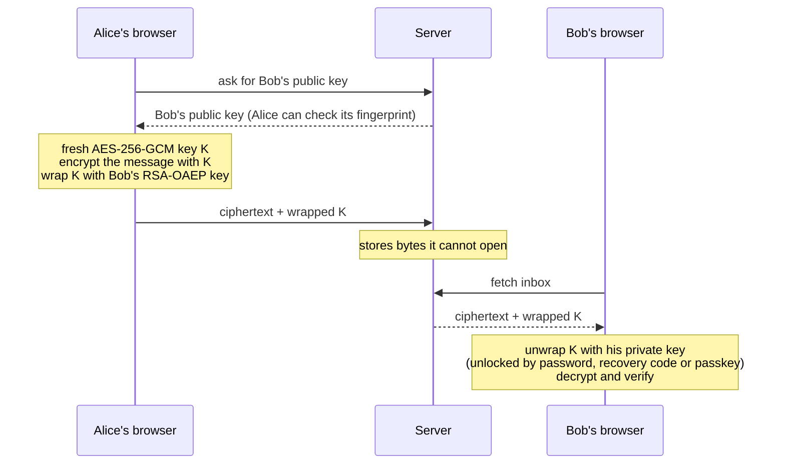

# Sealed Mail

Self-hosted webmail where **the server only ever stores ciphertext**. Messages are
encrypted in the browser; the server never sees a message body, a private key or a
password, so there is nothing on it worth reading, leaking or training a model on.

**[Play the server →](https://nacho995.github.io/sealed-mail/)**: an interactive demo
where *you* are the server holding Alice's mail to Bob, and you try to read it. It
runs the app's own crypto module in your browser. The demo UI is in Spanish.

[](https://nacho995.github.io/sealed-mail/)

## Five attacks you can run in the demo

| Step | You try to… | What happens | Why |
|---|---|---|---|
| 1. Listen | read what you store | random-looking bytes, different on every keystroke | each message gets a fresh AES-256-GCM key and IV; only Bob's browser holds the key that opens it |
| 2. Tamper | flip one bit before delivering | Bob rejects the whole message | AES-GCM authenticates the ciphertext |
| 3. Swap the key | hand Alice your public key instead of Bob's | **it works**: you read it and re-seal it for Bob | encryption alone cannot stop a lying key server; the defence is comparing fingerprints, which the demo shows mismatching |
| 4. Brute-force | dictionary-attack Bob's password-wrapped key | a weak password falls live; a random one would take ~10⁶ years on 1 000 GPUs | 310 000 rounds of PBKDF2 per guess, measured in your browser |
| 5. Guess the recovery code | try random codes | nothing, ever | 160 random bits |

Step 3 is deliberate: it is a real limitation of every web-delivered end-to-end
system, and pretending otherwise would be the dishonest part.

## The app

| Sign in | Inbox | Security |
|---|---|---|
|  |  |  |

- Register and log in with a password; a **recovery code** shown once at sign-up.
- **Face ID / Touch ID / security keys** through WebAuthn passkeys with the PRF
  extension: the biometric never leaves the device, the unlock secret never reaches
  the server.
- Compose, send, read. Recipient **key fingerprints** for out-of-band verification;
  the sender shown is the one the server authenticated, and a client-claimed
  `from` that disagrees is flagged.
- Security panel: your fingerprint, rotate the recovery code, add or remove devices,
  sign out other sessions. Anything that changes how the account opens re-checks the
  password on the server.

## How it works



Bob's private key exists on the server only as three wrapped copies, each under a
secret that never leaves his side:

| Copy | Wrapped under | Where that secret lives |
|---|---|---|
| password | PBKDF2-SHA256, 310 000 rounds | Bob's memory |
| recovery code | PBKDF2 of 160 random bits | paper / password manager |
| each passkey | HKDF of the WebAuthn PRF output | the device's secure chip |

## What the server can and cannot do

| | |
|---|---|
| Read stored mail | **No**: ciphertext only |
| Alter a message unnoticed | **No**: AES-GCM authentication |
| Learn passwords | **No**: it receives a PBKDF2-derived key and stores `scrypt` of it |
| Tell which addresses have accounts | **Partly**: login, recovery and passkey sign-in give constant-shape answers (fake salts, usernameless passkeys), but sign-up says when an address is taken and logged-in users can look up recipients |
| Hand out a fake public key | **Yes**, unless users compare fingerprints (demo step 3) |
| Serve malicious JavaScript | **Yes**: inherent to web-delivered E2E, not solved here |
| See who mails whom, and when | **Yes**: metadata is not hidden |

The full threat model, every hardening measure and the honest limitations are in
[`docs/SECURITY.md`](docs/SECURITY.md).

## How it was built

Built with an agentic workflow: one coding agent implementing, and a separate
read-only application-security agent auditing the finished code twice without
sharing the implementer's reasoning. The second audit found a high-severity flaw
(enrolling a passkey required the password only in the UI, not on the server) which
was fixed and is now covered by a test, along with every other finding.

## Run it

Requires Node.js **22.13 or newer** (uses the built-in `node:sqlite`, so there is no
native build and nothing to compile).

```bash
git clone https://github.com/nacho995/sealed-mail.git
cd sealed-mail
npm install

# .env from the example with a fresh random secret (the server refuses to start
# with the placeholder, a weak value, or no secret at all)
node -e "const fs=require('fs');const s=require('crypto').randomBytes(32).toString('hex');fs.writeFileSync('.env',fs.readFileSync('.env.example','utf8').replace(/^SESSION_SECRET=.*$/m,'SESSION_SECRET='+s))"

npm start
```

Open http://localhost:3000, create two accounts in two private windows and write
between them.

### Face ID / Touch ID

1. Use **Safari** or **Chrome** on `localhost` (not `127.0.0.1`: passkeys are bound
   to the hostname).
2. Log in, open **Seguridad**, name the device, press **Añadir este dispositivo**,
   confirm the password, then **Usar Face ID o Touch ID ahora** (two presses because
   Safari only starts the biometric prompt right after a click).
3. Log out and press **Entrar con Face ID o Touch ID**. No email needed.

If the browser cannot do PRF, the app says so instead of enrolling a passkey that
could sign in but not decrypt. In production set `RP_ID` and an `https` `ORIGIN` in
`.env`, and put the app behind HTTPS.

### Tests

```bash
npm test
```

Starts the real server on a free port with a throwaway database, then drives it with
the real browser crypto module: sending and decrypting, recovery (including two
simultaneous recoveries racing for the same code), password re-checks, passkey
defences, session revocation and error handling. CI runs it on Node 22 and 24.

### The demo locally

```bash
node demo/build.mjs   # assembles _site/ from demo/ plus the app's crypto, CSS and fonts
```

## Out of scope (for now)

- **Mail to and from the outside world** (Gmail, Outlook…), which needs SMTP/IMAP,
  a domain and SPF/DKIM/DMARC. Sealed Mail is a closed system between users of one
  instance.
- Attachments, threads, search over encrypted bodies, forward secrecy.

## Layout

```
server/        Express app: auth, recovery, passkeys, mail, rate limits, CSP
public/        the web app (no inline scripts); js/crypto.js holds ALL cryptography
demo/          "play the server" (built to GitHub Pages)
tests/e2e.mjs  end-to-end test suite
docs/          SECURITY.md and README images
```

## Design

Ink on paper, with one motif: the security tint printed inside envelopes so a letter
cannot be read against the light. Everywhere it appears it means "this is what
everyone else sees". Type: **Source Serif 4** for what people write, **Atkinson
Hyperlegible** for the interface and its Mono cut for strings copied character by
character (recovery codes, fingerprints), designed so `0/O` and `l/1/I` cannot be
confused. All fonts are SIL Open Font License 1.1, self-hosted.
