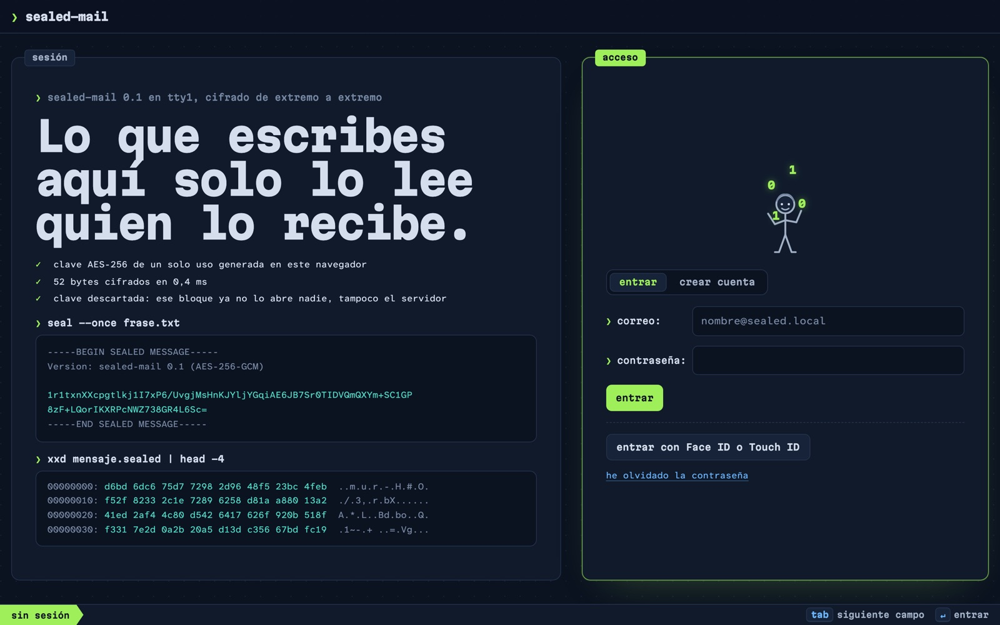
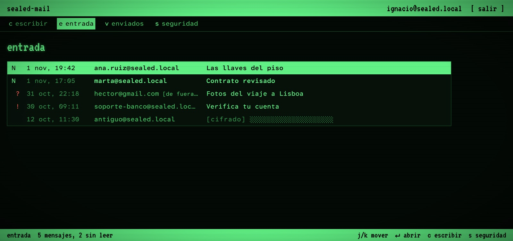
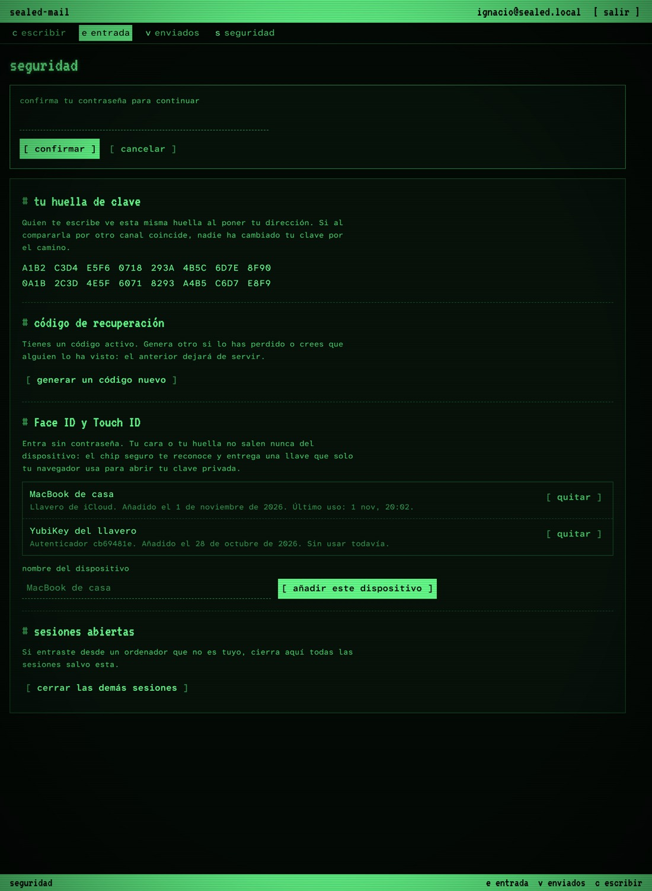
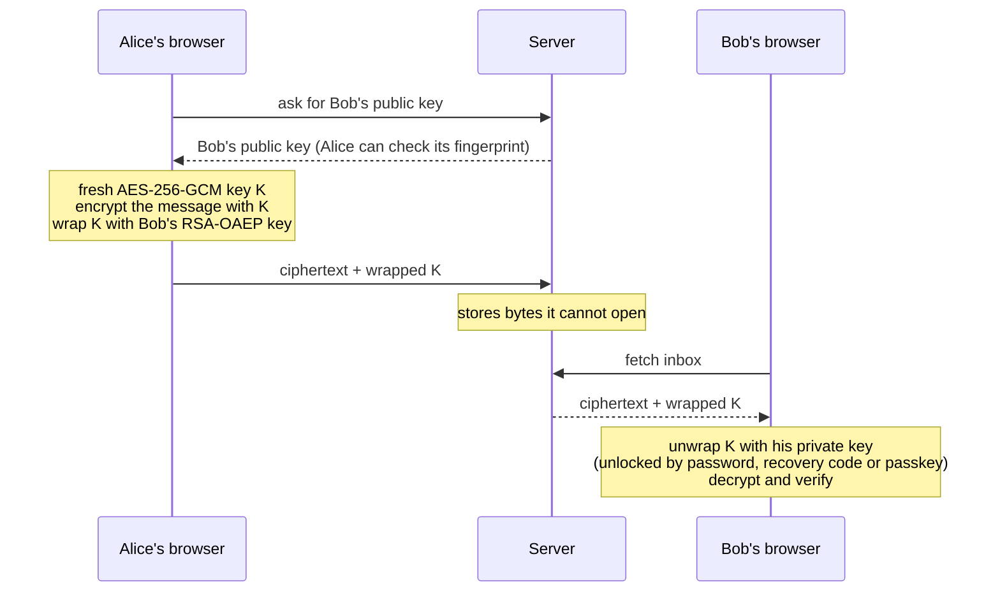

# Sealed Mail

Your own webmail, where **the server only ever stores ciphertext**. Write to anyone
(Gmail, Outlook, any address) and receive mail like any email service, with one
difference: nothing stored on the server can be read by the server, so there is
nothing on it worth reading, leaking or training a model on.

- **Between Sealed Mail users**: end-to-end encrypted. Messages are encrypted in the
  sender's browser and opened only in the recipient's.
- **With everyone else** (ordinary email over SMTP): mail that arrives is sealed with
  your key the moment it is received, so only ciphertext is ever written; mail you
  send out leaves as a normal email (the other side cannot read anything else), the
  app warns you before sending, and your Sent copy is stored encrypted.

> [!IMPORTANT]
> **Pending: email with the outside world is not live yet.** The code is finished
> and tested (SMTP in and out, sending through Resend or SendGrid, receiving polled
> from Resend: 33 end-to-end checks). What is missing is infrastructure, not code.
> Real delivery needs **a domain you own whose DNS points at the mail provider**, and
> for this deployment those DNS records were never added. As things stand:
>
> | | Status |
> |---|---|
> | Mail between Sealed Mail users (end-to-end encrypted) | ✅ works |
> | Writing to / receiving from Gmail, Outlook… **on your machine** (Mailpit, `npm run mail:test`) | ✅ works |
> | Writing to / receiving from Gmail, Outlook… **over the internet** | ❌ **not active: needs a verified domain** |
>
> To turn it on:
> 1. Add a domain or subdomain you own in Resend, with sending and receiving enabled
>    (a subdomain such as `mail.example.com` keeps your existing mailboxes untouched).
> 2. Create the DNS records Resend lists (DKIM TXT, SPF MX + TXT, return-path
>    CNAME, inbound MX) at your DNS provider, and verify the domain in Resend.
> 3. Set the Resend block of `.env.example` in your `.env` and restart.
>
> To only *send* without a domain, `npm run setup:sendgrid` uses SendGrid's
> single-sender verification instead (replies then go to that address, not to the app).

## The app

| Sign in | Inbox | Security |
|---|---|---|
|  |  |  |

- **Write to any address.** Sealed Mail recipients get end-to-end encryption; any
  other address gets an ordinary email through your SMTP relay (Mailpit locally,
  SendGrid or any SMTP provider for real delivery).
- **Receive from anyone.** A built-in SMTP server accepts mail for your accounts
  only (never an open relay), seals it on arrival and flags it "from outside,
  sender not verified", because ordinary email cannot prove who sent it.
- Register and log in with a password; a **recovery code** shown once at sign-up.
- **Face ID / Touch ID / security keys** through WebAuthn passkeys with the PRF
  extension: the biometric never leaves the device, the unlock secret never reaches
  the server.
- Compose, send, read. Recipient **key fingerprints** for out-of-band verification;
  the sender shown is the one the server authenticated, and a client-claimed
  `from` that disagrees is flagged.
- Security panel: your fingerprint, rotate the recovery code, add or remove devices,
  sign out other sessions. Anything that changes how the account opens re-checks the
  password on the server.

## How it works



Bob's private key exists on the server only as three wrapped copies, each under a
secret that never leaves his side:

| Copy | Wrapped under | Where that secret lives |
|---|---|---|
| password | PBKDF2-SHA256, 310 000 rounds | Bob's memory |
| recovery code | PBKDF2 of 160 random bits | paper / password manager |
| each passkey | HKDF of the WebAuthn PRF output | the device's secure chip |

## What the server can and cannot do

| | |
|---|---|
| Read stored mail | **No**: ciphertext only |
| Read mail exchanged with outside addresses | **In transit, yes**: ordinary email is plaintext by nature, so the server holds it in memory while delivering or sealing it. It is never written in the clear |
| Alter a message unnoticed | **No**: AES-GCM authentication |
| Learn passwords | **No**: it receives a PBKDF2-derived key and stores `scrypt` of it |
| Tell which addresses have accounts | **Partly**: login, recovery and passkey sign-in give constant-shape answers (fake salts, usernameless passkeys), but sign-up says when an address is taken and logged-in users can look up recipients |
| Hand out a fake public key | **Yes**, unless users compare fingerprints |
| Serve malicious JavaScript | **Yes**: inherent to web-delivered E2E, not solved here |
| See who mails whom, and when | **Yes**: metadata is not hidden |

The full threat model, every hardening measure and the honest limitations are in
[`docs/SECURITY.md`](docs/SECURITY.md).

## How it was built

Built with an agentic workflow: one coding agent implementing, and a separate
read-only application-security agent auditing the finished code twice without
sharing the implementer's reasoning. The second audit found a high-severity flaw
(enrolling a passkey required the password only in the UI, not on the server) which
was fixed and is now covered by a test, along with every other finding.

## Run it

Requires Node.js **22.13 or newer** (uses the built-in `node:sqlite`, so there is no
native build and nothing to compile).

```bash
git clone https://github.com/nacho995/sealed-mail.git
cd sealed-mail
npm install

# .env from the example with a fresh random secret (the server refuses to start
# with the placeholder, a weak value, or no secret at all)
node -e "const fs=require('fs');const s=require('crypto').randomBytes(32).toString('hex');fs.writeFileSync('.env',fs.readFileSync('.env.example','utf8').replace(/^SESSION_SECRET=.*$/m,'SESSION_SECRET='+s))"

npm start
```

Open http://localhost:3000/ and create an account (your address will be
`nombre@sealed.local`). From there you can write to anyone.

### Email with the outside world

Out of the box everything stays on your machine. Outgoing mail is caught by Mailpit
(web inbox at http://localhost:8025/):

```bash
brew install mailpit && mailpit
```

To simulate someone outside writing to you (as another mail server would):

```bash
npm run mail:test -- nombre@sealed.local "Hola" "Escrito desde fuera"
```

**Sending for real (to any Gmail, Outlook… address) with SendGrid**, no domain needed:

1. In SendGrid, *Settings → Sender Authentication → Single Sender Verification*:
   verify an address you own (for example your Gmail).
2. *Settings → API Keys*: create a key with the **Mail Send** permission only.
3. Run `npm run setup:sendgrid` in your terminal. It asks for the verified address and
   the key (the key is not shown while you type), checks the key with SendGrid,
   writes `.env` with permissions 600 and can send you a test email. Or edit `.env`
   by hand (never commit it), replacing the two `SMTP_OUT_*` lines with:
   ```
   SMTP_OUT_HOST=smtp.sendgrid.net
   SMTP_OUT_PORT=587
   SMTP_OUT_USER=apikey
   SMTP_OUT_PASS=<your API key>
   SMTP_OUT_FROM=<the address you verified>
   ```
4. Restart. Mail now goes out from the verified address, showing your Sealed Mail
   name, and replies arrive at that address. The connection to the relay must use
   TLS: the app refuses to send in clear text to any relay other than localhost.

**Sending and receiving with your own domain through Resend** (recommended): add a
subdomain you own in Resend with sending and receiving enabled (for example
`mail.example.com`, so the main domain's existing mailboxes are untouched), create the
DNS records Resend lists, then set in `.env` the Resend block shown in
`.env.example`. Outgoing mail leaves from each user's own address. Incoming mail is
**polled** from Resend's API every 15 seconds, so the app needs no public URL. Each
message is sealed on arrival like any other, and the sender is marked verified when
DMARC passed.

Without a domain of your own, deliverability is limited (a gmail.com sender sent
through SendGrid may land in spam). **Receiving mail from the internet** needs a
domain whose MX record points at this server, with the SMTP port exposed over TLS;
set `MAIL_DOMAIN` to it and the same code handles it.

### Face ID / Touch ID

1. Use **Safari** or **Chrome** on `localhost` (not `127.0.0.1`: passkeys are bound
   to the hostname).
2. Log in, open **Seguridad**, name the device, press **Añadir este dispositivo**,
   confirm the password, then **Usar Face ID o Touch ID ahora** (two presses because
   Safari only starts the biometric prompt right after a click).
3. Log out and press **Entrar con Face ID o Touch ID**. No email needed.

If the browser cannot do PRF, the app says so instead of enrolling a passkey that
could sign in but not decrypt. In production set `RP_ID` and an `https` `ORIGIN` in
`.env`, and put the app behind HTTPS.

### Tests

```bash
npm test
```

Starts the real server on a free port with a throwaway database, then drives it with
the real browser crypto module: sending and decrypting, real SMTP in and out (with a
stand-in outside mail server, a byte-level check that incoming plaintext never
reaches the database, and open-relay refusal), recovery (including two simultaneous
recoveries racing for the same code), password re-checks, passkey defences, session
revocation and error handling. CI runs it on Node 22 and 24.

## Out of scope (for now)

- **Receiving from the internet** needs a domain (MX record) and the SMTP port
  exposed with TLS; sending already works through any relay.
- Attachments (incoming ones are dropped with a note), HTML mail (shown as text),
  threads, search over encrypted bodies, forward secrecy.

## Layout

```
server/        Express app: auth, recovery, passkeys, mail, rate limits, CSP,
               SMTP in (smtp-in.js) and out (smtp-out.js)
scripts/       send-test-mail.mjs: "someone outside writes to you"
public/        the web app (no inline scripts); js/crypto.js holds ALL cryptography
tests/e2e.mjs  end-to-end test suite
docs/          SECURITY.md and README images
```

## Design

Ink on paper, with one motif: the security tint printed inside envelopes so a letter
cannot be read against the light. Everywhere it appears it means "this is what
everyone else sees". Type: **Source Serif 4** for what people write, **Atkinson
Hyperlegible** for the interface and its Mono cut for strings copied character by
character (recovery codes, fingerprints), designed so `0/O` and `l/1/I` cannot be
confused. All fonts are SIL Open Font License 1.1, self-hosted.
